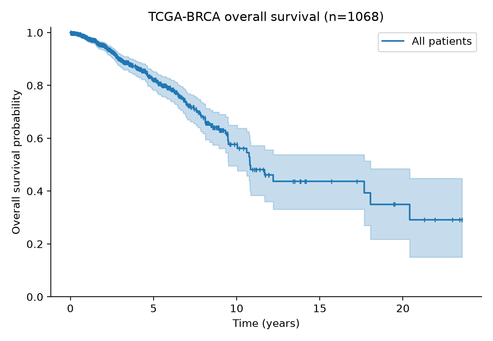

# Breast Cancer Survival Prediction from Gene Expression (TCGA-BRCA)

Can a tumor's gene expression profile predict how long a breast cancer patient will survive, and does it add anything beyond standard clinical information such as age and stage?

This project builds and compares survival models on the TCGA-BRCA cohort (about 1,000 patients, about 60,000 genes) using Cox regression and Random Survival Forests, and benchmarks them against a clinical-only baseline.

## Motivation

Breast cancer outcomes vary widely, even among patients with the same stage. Gene expression can capture tumor biology that clinical variables miss, but expression data is high-dimensional (far more genes than patients), so models easily overfit and report inflated performance. This project focuses on doing the evaluation honestly:

- feature selection is done **inside** cross-validation folds to avoid data leakage
- every genomic model is compared with a **clinical-only baseline**
- results are reported with uncertainty, not a single lucky split

## Data

| Item | Details |
|---|---|
| Source | [UCSC Xena](https://xenabrowser.net/), GDC TCGA Breast Cancer (BRCA) hub |
| Expression | STAR gene expression, log2(TPM + 1) |
| Outcome | Overall survival: `OS` (1 = death, 0 = censored) and `OS.time` (days) |
| Samples | Primary tumors only (TCGA sample type `01`), one sample per patient |

Raw data is not included in this repository. See [Setup](#setup) for how to download it.

## Methods

1. **Data preparation:** filter to primary tumors, remove missing or invalid follow-up times, match expression to survival data, remove genes with no expression.
2. **Exploratory survival analysis:** Kaplan-Meier estimates for the whole cohort.
3. **Clinical baseline:** Cox proportional hazards model using age and stage.
4. **Feature selection:** variance filtering followed by univariate Cox screening, performed only on training folds.
5. **Genomic models:** penalized Cox regression (Coxnet, elastic net) and Random Survival Forest.
6. **Evaluation:** cross-validated concordance index (C-index), compared across models.
7. **Interpretation:** high-risk vs low-risk groups with Kaplan-Meier curves and log-rank test, plus the most informative genes.

## Results

*Results will be added as the analysis is completed.*

| Model | C-index (mean ± SD, CV) |
|---|---|
| Clinical only (age + stage) | TBD |
| Coxnet (genes) | TBD |
| Random Survival Forest (genes) | TBD |
| Clinical + genes | TBD |

Overall survival in the cohort:



## Repository structure

```
tcga-brca-survival/
├── data/                 # raw and processed data (not tracked by git)
├── notebooks/            # analysis notebooks
├── src/                  # reusable Python code
├── results/figures/      # saved plots
├── environment.yml       # conda environment
└── README.md
```

## Setup

**1. Clone the repository and create the environment**

```bash
git clone https://github.com/YOUR-USERNAME/tcga-brca-survival.git
cd tcga-brca-survival
conda env create -f environment.yml
conda activate tcga
```

**2. Download the data** from [UCSC Xena](https://xenabrowser.net/) (GDC TCGA Breast Cancer cohort) and place these files in `data/`:

- `TCGA-BRCA.star_tpm.tsv.gz`
- `TCGA-BRCA.survival.tsv`

**3. Run the notebooks**

```bash
jupyter lab
```

Open the notebooks in `notebooks/` and run them in numerical order.

## Tools

Python, pandas, NumPy, SciPy, lifelines, scikit-survival, scikit-learn, Matplotlib, Seaborn, JupyterLab.

## Limitations

- TCGA is a retrospective cohort with limited follow-up for many patients, and most patients are censored.
- There is no external validation cohort, so performance may not generalize to other populations.
- Overall survival includes deaths unrelated to cancer.

## Data and license

TCGA data is publicly available under the [GDC data access policies](https://gdc.cancer.gov/access-data/data-access-processes-and-tools). Code in this repository is released under the MIT License.

## Author

**Your Name**: [GitHub](https://github.com/YOUR-USERNAME) · [LinkedIn](https://www.linkedin.com/in/YOUR-PROFILE)
